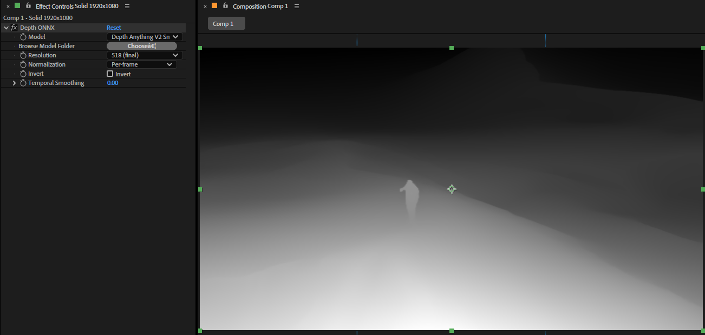

# Depth ONNX

フレームごとの正規化で、有限な極端値からNaNが生じる不具合を修正しました。
通常範囲は従来のfloat計算を保ち、範囲差や逆数が表現できない場合だけ倍精度で計算します。
一定範囲は0とし、非有限値・逆転した範囲・範囲外の値は変更前に拒否します。
極端に広い／狭い範囲と通常計算の一致を直接検査しました。未解決のFixed rangeの実装や
モデル推論の検証ではありません。

形式を明示したテスト用PF_LayerDefで実際のCPU読み書きループを検査しました。
8/16/32bit、細長い／奇数サイズ、正負の余白付き行幅を組み合わせた18配置で入力が一致し、
16bit下位ビットとfloatの負値・HDRも保持します。反転を含む一定深度の36書き込みで
行の余白と前後の保護領域が保持されました。ホストの形式取得と推論は迂回しているため、
実AEの画像受け渡しや任意の深度画像の保証ではありません。

CPU画像変換では、画素参照前に寸法、ポインターの非NULLとアラインメント、符号付き行幅、
行容量、アドレス計算の範囲を検査します。正常な負の行幅は許容します。不正な配置と確保失敗は、
成功扱いのパススルーではなくエラーで返します。余白付き行、負の行幅、細長い／奇数サイズ、
不正な値とオーバーフローを直接検査しました。ただしホストポインターの実際の確保領域までは
証明できません。修正DLLのモデル不足3件は入力と同一の出力を維持しましたが、通知は未検証です。

モデル未登録の直接テストでは空のカタログをモデル選択へ渡し、実際のPF_OutDataへ通知を
設定したうえで、代替コピーと画像返却の成功・失敗4組を検査します。通知フラグとコピー側の
エラー優先を確認し、代替コピー成功時には16bit下位ビットも保持します。ただしコピーは
テスト用の処理であり、AEのSmart Renderや実ホストのコピーを実行した検査ではありません。
既存の3件の`blocked_error_notification_unverified`を合格には変更しません。

[日本語](./README.ja.md) | [English](./README.md)



Depth ONNX は、ONNX Runtime を用いて単眼深度マップを推論する Adobe After Effects 用 SmartFX プラグインです。

Depth Anything などの ONNX モデルは同梱しません。`manifest.json` と `.onnx` を含むモデルパックを所定の `models/` フォルダに置いて使用します。リポジトリには [Depth Anything V2 Small](https://huggingface.co/depth-anything/Depth-Anything-V2-Small-hf) 向けの設定例（`model/depth_anything_v2_small/manifest.json`）が入っています。

> 仕様、UI、パラメータ名、初期値は今後変更される可能性があります。

## Name

- 表示名: `Depth ONNX`
- After Effects match name: `ANTH DepthONNX`
- プラグインファイル名:
  - Windows: `DepthONNX.aex`
  - macOS: `DepthONNX.plugin`

## Main Features

- ONNX Runtime による単眼深度推論（Windows: DirectML、macOS: CPU）
- `manifest.json` ベースの汎用モデルパック（Depth Anything 専用ではない）
- 解像度プリセット 266 / 392 / 518（モデルパックの variants に依存）
- フレームごとの正規化、反転、時間方向スムージング
- Browse Model Folder による任意フォルダのスキャン
- After Effects Smart Render 対応

## Validation Status

Smart Render処理中のパニックでも、取得済み入力を返却してから元のパニックを伝播します。修正前に返却回数が0になることを再現し、修正後は1回の返却と元のパニック保持を単体検査しています。プロセス強制終了やドライバー障害、実AEでのパニック回復まで検証したものではありません。

- Adobe After Effects 2025 / 2026 / Windows で動作確認済み
- Depth Anything V2 Small（ONNX export）でエンドツーエンド確認済み
- macOS ビルド手順はリポジトリ上で用意（実機検証は未記載）
- アダプターの単体テストは、画素形式、深度データの形状・有限性、補間、平滑化履歴の再利用・解放、成功／失敗時の入力返却を対象とします。このディレクトリで `cargo test --release --locked --offline -p depthonnxae` を実行できます。
- モデル・ランタイム・推論の失敗時は、従来のエラー通知を設定し、入力を出力へコピーします。最新のAEXCompat検査では8/16/32 bpcで入力と出力が一致しましたが、期待したエラー通知は確認できていません。推論やエラー処理全体の合格を意味しません。
- 平滑化履歴の保持は最大256件・ベクタ容量256MiBです。上限超過時は履歴を追い出さず、現在の画像も変更せずOutOfMemoryを返します。確保失敗もエラーにします。小さい予算で拒否・履歴保持・無効化後の容量再利用を単体検査しています。置換中は旧・新ストレージが同時に存在するため、瞬間的なメモリ使用量やプロセスRSSの上限ではありません。
- SequenceSetdownで対象エフェクトの履歴を削除し、GlobalSetdownで全履歴とマップ領域を解放します。重複削除、他の識別子の履歴保持、識別子再利用時に古い履歴を混ぜないことを単体検査しています。実AEのライフサイクルやMFRの呼び出し順の保証ではありません。
- 実モデルでの推論、非連続な描画順やMFRでの履歴処理は引き続き検証が必要です。

## Build

### Windows

Visual Studio 2022（MSVC）、Rust、`just`（任意）、ONNX Runtime GPU パッケージ（`third_party/onnxruntime-win-x64-gpu-*`）が必要です。

`AdobePlugin.just` が存在しない `sdk/AfterEffectsSDK` を `AESDK_ROOT` に設定するため、`just release` は環境によって失敗します。次の手順が確実です。

```powershell
cd crates\depth-onnx-ae
Remove-Item Env:AESDK_ROOT -ErrorAction SilentlyContinue
$env:CARGO_TARGET_DIR = "..\..\target"
cargo build --release
Copy-Item -Force ..\..\target\release\depthonnxae.dll ..\..\target\release\DepthONNX.aex
Copy-Item -Force ..\..\third_party\onnxruntime-win-x64-gpu-1.24.4\lib\*.dll ..\..\target\release\
```

出力:

```text
target\release\DepthONNX.aex
target\release\onnxruntime.dll
target\release\onnxruntime_providers_shared.dll
```

AE SDK で bindgen ビルドする場合は、ビルド前に `AESDK_ROOT` を実在パスに設定してください。

### macOS

```bash
cd crates/depth-onnx-ae
export CARGO_TARGET_DIR=../../target
# export AESDK_ROOT=/path/to/AfterEffectsSDK  # 未設定時は同梱 bindings を使用
just release-bundle
```

`third_party/onnxruntime-osx-arm64/lib/libonnxruntime.1.24.4.dylib` を配置してから `release-bundle` を実行してください（`post-bundle` が Frameworks にコピーします）。

## Installation

### Windows（MediaCore）

After Effects を閉じてから、管理者権限の PowerShell で以下を実行します。

```powershell
$dst = "C:\Program Files\Adobe\Common\Plug-ins\7.0\MediaCore"
$repo = (Get-Location).Path

Copy-Item -Force "$repo\target\release\DepthONNX.aex" $dst
Copy-Item -Force "$repo\target\release\onnxruntime.dll" $dst
Copy-Item -Force "$repo\target\release\onnxruntime_providers_shared.dll" $dst

$models = "$dst\models\depth_anything_v2_small"
New-Item -ItemType Directory -Force -Path $models | Out-Null
Copy-Item -Force "$repo\model\depth_anything_v2_small\*" $models
```

コピー先:

```text
C:\Program Files\Adobe\Common\Plug-ins\7.0\MediaCore\
  DepthONNX.aex
  onnxruntime.dll
  onnxruntime_providers_shared.dll
  models\<pack>\
    manifest.json
    *.onnx
```

After Effects を再起動し、`Effects > Depth > Depth ONNX` からエフェクトを適用します。

補助スクリプト: [`scripts/install_dev.bat`](scripts/install_dev.bat)（`Effects\DepthONNX\` 向け。MediaCore 直置きの場合は上記手動コピーを推奨）。

### macOS

```bash
./scripts/install_dev.sh
```

コピー先:

```text
/Library/Application Support/Adobe/Common/Plug-ins/7.0/MediaCore/
  DepthONNX.plugin
  DepthONNX/models/<pack>/
    manifest.json
    *.onnx
```

生成された `.aex` / `.plugin` / `.dll` などのビルド成果物は Git にコミットしません。

## Models

ONNX ファイルはリポジトリに含まれません（`.gitignore`）。初回は export スクリプトで生成します。

```bash
pip install -r scripts/requirements.txt
pip install onnxscript

python scripts/export_onnx.py --static-shape --size 518 --out model/depth_anything_v2_small/depth_anything_v2_small.onnx
python scripts/export_onnx.py --static-shape --size 266 --out model/depth_anything_v2_small/depth_anything_v2_small_266.onnx
python scripts/export_onnx.py --static-shape --size 392 --out model/depth_anything_v2_small/depth_anything_v2_small_392.onnx
```

重みは [Hugging Face: Depth-Anything-V2-Small-hf](https://huggingface.co/depth-anything/Depth-Anything-V2-Small-hf) から `export_onnx.py` 実行時に自動取得されます（キャッシュ: `~/.cache/huggingface/`）。

詳細は [`model/README.md`](model/README.md)。

## Parameters

- `Model`: スキャンしたモデルパックを選択
- `Browse Model Folder`: 任意のモデルルートを指定（`Choose…`）
- `Resolution`: `266 (preview)` / `392 (preview HQ)` / `518 (final)`
- `Normalization`: `Per-frame` / `Fixed range`
- `Invert`: 深度の白黒反転
- `Temporal Smoothing`: 時間方向の指数移動平均（0.00–0.95）

## Development Checks

```powershell
cargo fmt
cargo check
cargo build --release
```

```bash
# macOS
cd crates/depth-onnx-ae && just release-bundle
```

## Environment Variables

| 変数 | 用途 |
|------|------|
| `AESDK_ROOT` | AE SDK パス（bindgen ビルド時） |
| `CARGO_TARGET_DIR` | ビルド出力先（既定: `target/`） |
| `ORT_DYLIB_PATH` | ONNX Runtime ライブラリの明示パス（開発用） |
| `AE_DEPTH_ONNX_MODEL_DIR` | モデルスキャンルートの追加 |
| `AE_DEPTHANYTHING_MODEL_DIR` | 上記の旧名（互換） |

## Limitations

- 推論エンジンの再設定ではIDだけでなくマニフェスト全体を比較します。同じIDでもONNXファイル名やテンソル名が変われば設定を更新し、セッションを破棄します。5項目の変更・同一設定の再指定・フォルダ変更をモデル不要のテストで確認しています。実ランタイムでの破棄と再読み込み、同名ファイルの上書き検出、カタログの自動再走査は未検証です。
- Normalizationの`Fixed range`は現在反映されず、常にフレームごとの最小・最大値で正規化されます。マニフェストにも固定範囲の定義がなく、未解決のパラメータ仕様として残っています。
- 推論前の拡大では、補間前の座標を画像の範囲内に収め、端の画素に隣の画素が混ざる不具合を修正しました。2×2から4×4への拡大をARGB・RGBAの両方で数値検査しています。実モデルの出力検証ではありません。
- エラー通知はUTF-8の文字境界を保って255バイト以内に収め、終端と残りの領域をゼロで埋めます。途中のNULは空白に置き換えます。長いASCII・日本語の通知と出力領域の再利用を単体テストで確認していますが、ホスト上のエラー表示や実推論の保証ではありません。
- モデルパックごとに `manifest.json` の IO 名・前処理が一致している必要がある
- Windows: `onnxruntime.dll` を `.aex` と同じフォルダに配置する必要がある
- macOS: ORT dylib はバンドル `Contents/Frameworks/` に同梱（`release-bundle`）
- 深度推論は CPU/GPU（DirectML）負荷が高く、解像度・プレビュー設定に注意
- アダプターの単体テストがあります。対象と未検証事項は上のValidation Statusを参照してください。

## License

- プラグイン: MIT License. See [LICENSE](LICENSE).
- Depth Anything V2: Apache-2.0（別途取得）
- ONNX Runtime / AE SDK: 各ライセンスに従う
