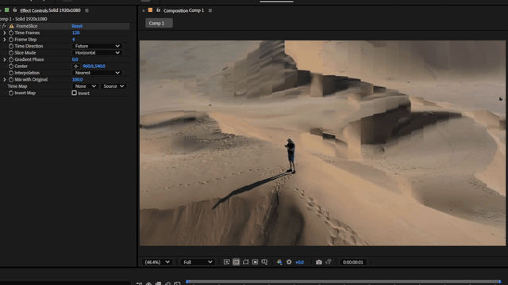

# FrameSlice

[English](./README.md) | [日本語](./README.ja.md)



FrameSlice is an Adobe After Effects effect plug-in for creating slit-scan style time offsets inside image layers.

It samples each pixel from a different point in time, using horizontal, vertical, radial, or map-layer driven time maps.

Temporal checkout times use integer quotient/remainder rounding. Floating-point
calculation previously selected -10 instead of -11 at a half-frame boundary
(64-frame range,7 samples,past direction,index5). A1200-case integer reference
covers directions, sample counts and signed host-time limits. Current AEXCompat
declarative fixtures supply a single image plus timing, not time-indexed image
sequences; static host passes do not certify real temporal checkout behavior.

A synthetic time-indexed frame provider also connects those corrected times to
CPU and actual-GPU pixel sampling. Three directions and nearest/linear sampling
match explicitly listed reference ticks/pixels exactly (six CPU and six GPU
renders), including the affected half-frame boundary. This is a direct integration
test, not AE's native temporal checkout or GPU-world transport.

> Specifications, UI, parameter names, and defaults may change in future versions.

## Name

- Display name: `FrameSlice`
- After Effects match name: `FrameSlice`
- Plugin file name:
  - Windows: `FrameSlice.aex`
  - macOS: `FrameSlice.plugin`

## Main Features

- Time-based slit-scan sampling of the input layer
- Horizontal, vertical, radial, and map-layer driven time maps
- Past, future, and bidirectional time ranges
- Nearest or linear interpolation between sampled frames
- Blend control for mixing the result back toward the original frame
- Internal GPU processing through `wgpu` with CPU fallback
- After Effects Smart Render support

## Validation Status

- Tested on Adobe After Effects 2025 / Windows
- Current implementation supports 8-bit ARGB only
- Deep Color / 32-bit float pixel formats are not supported
- After Effects native `SmartRenderGpu` path is not implemented
- Eight unit/GPU tests cover interpolation-before-mix rounding, allocation limits, nearest midpoint parity, absent/empty map fallback, temporal tile placement/clipping, direction/endpoints, signed host-time bounds,
  and selection/interpolation of distinct frame contents. The audit reproduced
  future time wrapping negative, then fixed it with wide arithmetic and bounded
  host ticks. WideTimeInput now declares cross-time dependencies.
- The static-input audit also covers Map Layer mode without a selected map.
  Empty map checkouts use the documented horizontal fallback; a real black map
  remains a constant time map. These checks do not certify time-varying host
  checkouts, temporal cache invalidation, auxiliary maps or changing frame bounds.
- Differently sized temporal tiles are now placed at their original coordinates
  with transparent exterior; equal-size/equal-origin tiles avoid another copy.
  Tile unit coverage is not an end-to-end host ROI certificate.
- GPU allocation/dispatch limits are checked before buffer creation; oversized
  requests fall back to CPU. Reduced frame counts release oversized cached GPU
  stacks. This does not bound total VRAM or CPU temporal memory. Actual GPU
  nearest/linear tests caught and fixed ties-to-even selecting a different frame
  than CPU at midpoint; device-loss/OOM recovery remains unverified.

## Build

On Windows, run this from the repository root:

```powershell
cargo build --release
```

Output:

```text
target\release\frame_slice.dll
```

Rename or copy the built DLL to `FrameSlice.aex` before installing it into After Effects.

## Installation

### Using a local Windows build

Close After Effects, then run PowerShell as administrator:

```powershell
cargo build
Copy-Item -Force target\debug\frame_slice.dll "C:\Program Files\Adobe\Common\Plug-ins\7.0\MediaCore\FrameSlice.aex"
```

For a release build:

```powershell
cargo build --release
Copy-Item -Force target\release\frame_slice.dll "C:\Program Files\Adobe\Common\Plug-ins\7.0\MediaCore\FrameSlice.aex"
```

Destination:

```text
C:\Program Files\Adobe\Common\Plug-ins\7.0\MediaCore\
```

Restart After Effects and apply the effect from `Time > FrameSlice`.

Generated `.aex` / `.dll` files are not committed to Git.

## Parameters

- `Time Frames`: frame range sampled along the time axis, 2-1000
- `Frame Step`: interval between sampled frames, 1-100
- `Time Direction`: chooses `Past`, `Future`, or `Both`
- `Slice Mode`: chooses `Horizontal`, `Vertical`, `Radial`, or `Map Layer`
- `Gradient Phase`: offsets the generated time map
- `Center`: center point used by `Radial` mode
- `Interpolation`: chooses `Nearest` or `Linear` sampling
- `Mix with Original`: blends the processed result with the original frame
- `Time Map`: reference layer used by `Map Layer` mode
- `Invert Map`: inverts the time map

## Development Checks

```powershell
cargo fmt
cargo check
cargo test
cargo build --release
```

`cargo test` currently runs 0 tests.

## Environment Variables

The Adobe After Effects SDK is required at build time.

```powershell
$env:AESDK_ROOT = "C:\path\to\AfterEffectsSDK"
```

Set `AESDK_ROOT` for your local environment before building.

## Limitations

- 8-bit ARGB only
- Deep Color / 32-bit float rendering is not supported
- After Effects native GPU render path is not supported
- Classic `Render` checks out temporal frames and the time map, then shares the timing, alignment and compositor with Smart Render. Missing frames use the current input; checkout errors propagate. Distinct-frame orchestration has a direct regression test; static AEXCompat fixtures do not prove native AE temporal checkout.
- Run GPU unit tests serially (`cargo test --release --lib -- --test-threads=1`): the default-parallel suite stalled in the audit, while the serial suite passed. A separate two-worker run of all eight GPU-module tests passed; this does not explain the default-parallel stall or certify AE MFR.
- The current validation environment is Windows / After Effects 2025
- Automated unit tests cover temporal selection, tile alignment, missing maps,
  signed scanline orientation and internal GPU comparisons. Headless static-input
  host tests do not certify changing temporal checkout contents or native AE GPU worlds.
- Negative-stride input/output rows preserve logical orientation and row padding.
  Before buffer access, the adapter rejects unsupported formats, malformed dimensions,
  short/overflowing strides and nonempty null data. Input conversion allocation is
  fallible; output shape/channel length must match before writing.
  Checked-out input, temporal and map worlds now use
  scoped checkin on return/error/unwind, preserving the original work error.
  Closure fault tests verify cleanup ordering; they are not native host fault injection.
- Temporal frame collection, fallback copies and tile-alignment buffers reserve
  fallibly without reducing temporal samples. Alignment checks source length and
  destination products first; extreme offsets cannot overflow. Aggregate memory
  budgets and native allocation-failure injection remain separate work.
- CPU compositing now validates all frame, original and map lengths before sampling
  or passthrough, and propagates output allocation errors through the adapter.
  Nearest/linear interpolation and mix math are unchanged. Luminance and gradient
  maps validate size and reserve fallibly; resampling uses widened index products.
  Empty maps return before pixel iteration. This does not cap total concurrent memory.

負の行幅を持つ入出力で上下が逆になる問題を修正しました。行方向の4組と余白保持を
単体テストで確認しています。時間選択・領域配置・内部GPU比較にも自動テストがありますが、
静止入力のホスト検査だけでは実AEの時間別入力やネイティブGPU経路を保証できません。
画像アクセス前に形式・寸法・行幅・ポインタを検査し、入力変換の確保失敗をエラーで返します。
出力サイズと配列長の不一致も書き込み前に拒否します。取得済みの主入力・時間別画像・
マップはエラーやパニック時も返却し、元の処理エラーを優先します。返却順序の模擬テストは
実ホストへの障害注入ではありません。
時間別画像の一覧・代替コピー・領域配置の配列も確保失敗を返します。サンプル数は減らしません。
領域配置は配列長とサイズを検査し、極端な座標差でもオーバーフローしない計算を使います。
CPU合成本体は各画像とマップの長さを検査し、出力確保失敗を返すようになりました。
輝度・勾配マップもサイズを検査してから確保し、失敗を返します。拡大縮小の添字積を
広い整数型で計算し、空マップは画素ループ前に返します。補間・Mixの計算は維持しています。
同時描画を含む総メモリ上限と、実際のメモリ枯渇の検証は未完了です。

## GPU cache bounds

GPU upload-map and output host arrays reserve fallibly before GPU submission.
Readback uses scoped unmapping on success, error and unwind, after the mapped
view drops; an unexpected byte count returns to CPU fallback. Cleanup fault
tests use closures, not real device-loss injection.

GPU転送用マップと読み戻し先は処理送信前に確保し、失敗をCPU経路へ返します。
読み戻しは成功・エラー・パニック時に、参照を破棄してから解除します。
返却バイト数の不一致も拒否します。後始末の異常系は模擬テストであり、
実デバイス喪失の検証ではありません。

GPU cached buffers are limited to eight worker entries and 512 MiB of requested
buffer bytes per processor. Resize drops the previous entry before replacement;
least-recently-used entries are evicted before allocation. Oversized single jobs
fall back to the existing CPU renderer without reducing samples. Actual GPU tests
check buffer sizes and sequential worker eviction under a small test budget.
This is not a process RSS/driver VRAM limit or simultaneous MFR certification.

GPUバッファの保持は最大8組・要求容量合計512 MiBまでです。解像度変更時は旧領域を
先に解放し、上限を超える単体描画はサンプルを減らさずCPUへ戻します。
実GPUで小さい予算による退避を検査していますが、プロセス全体のメモリ・ドライバの
VRAM上限や同時MFR動作を保証するものではありません。

## Nearest-frame precision

With fewer than two temporal frames, GPU processing now delegates to the existing
CPU original-input passthrough. Previously a single sampled frame could be mixed
into output only on GPU. A regression reproduces that difference and checks zero/
one-frame fallback for both interpolation modes and Mix 0/0.5/1. Multi-frame GPU
execution remains covered separately; this is not host checkout-failure injection.

時間方向の入力が2枚未満の場合は、既存のCPU処理へ戻して元画像をそのまま返します。
従来は1枚だけの取得フレームをGPU側だけが合成していました。0枚・1枚、2種類の補間、
Mix 0・0.5・1で検査しています。複数フレームのGPU処理は維持しています。

Linear temporal interpolation is additionally compared on actual GPU across
2/3/4/7 frames, five Mix values, varying premultiplied colors/alpha and map values
around frame/byte-rounding boundaries. Twenty renders measured maximum error
1/255 against CPU; Mix zero is byte-identical. This uses the existing one-code
comparison allowance, not exact general CPU/GPU parity. No interpolation change
was made for this test.

線形補間は2・3・4・7フレーム、5種類のMix、色とアルファが異なる入力で実GPUと
CPUを比較します。境界付近を含む20描画の最大差は8bitの1段階、Mix 0は完全一致でした。
既存の1段階以内という比較基準であり、一般的な完全一致の保証ではありません。
この検査のために補間式は変更していません。

Nearest-frame GPU selection is computed in the CPU reference's f64 precision before
uploading exact indices. Previously f32 map conversion could select the next frame
just before a half-frame boundary. An actual-GPU regression checks before/at/after
three boundaries with distinct frame colors. Linear interpolation is unchanged;
this does not certify native AE temporal checkout or all map values.

NearestモードではCPUと同じ64bit精度でフレームを選び、確定した番号をGPUへ渡します。
従来は32bitへの変換で境界直前の値が丸められ、1フレーム先を選ぶ場合がありました。
異なる色のフレームを使い、3境界の直前・一致・直後を実GPUで検査しています。
線形補間は変更していません。実AEの時間方向の画像取得を保証する検査ではありません。

## License

MIT License. See [LICENSE](LICENSE).
