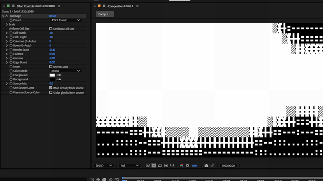

# TuiImage

[English](./README.md) | [日本語](./README.ja.md)



TuiImage is an After Effects effect for creating ANSI art / TUI-style cell renderings from image layers.

It samples the input image into a grid, maps brightness to procedural glyph density, and reconstructs the result with Mono, Source, or Gradient color modes. It does not emit ANSI escape sequences; it recreates that visual style inside After Effects.

> Specifications, UI, parameter names, and defaults may change in future versions.

## Name

- Display name: `TuiImage`
- After Effects match name: `TuiImage`
- Plugin file name:
  - Windows: `TuiImage.aex`
  - macOS: `TuiImage.plugin`

## Main Features

- Cell-based sampling of the input layer
- Procedural ANSI art / TUI-style, ASCII-style, Block-style, and Braille-style glyph rendering
- ASCII Classic / Block / Braille / TUI Gradient presets
- Adjustable cell size, glyph scale, column gap, and row gap
- Mono / Source / Gradient color modes
- Experimental GPU rendering path enabled only through an environment variable

## Validation Status

GPU output packing now rounds to nearest with positive half ties up, matching CPU instead of truncating. A spatial RGB regression passes byte-exact comparisons for Mono, Source and Gradient modes at Source Mix 0, 0.37 and 1. This is selected-case evidence, not exhaustive GPU parity.

The experimental GPU cache limits requested buffer storage to 256 MiB across cached thread entries and evicts least-recently-used entries before allocation. Oversized single requests use the existing CPU fallback. This accounting excludes driver overhead, deferred destruction and CPU memory; it is not a measured VRAM ceiling.

A direct GPU regression uses six distinct, sequential worker threads and a test-only two-frame budget: cached entries stay within the limit and each result matches CPU bytes. This verifies logical eviction, not simultaneous execution or physical VRAM release.

The explicit GPU regression also covers disabled source luma, preserved source color, glyph scales/gaps, four presets at nine gray levels, spatial edge boost, resizing, and twelve preset/contrast/gamma/inversion combinations on spatial RGB input. These selected cases match CPU bytes without fallback. They do not certify every control combination, device failure, or native AE GPU-world integration; GPU remains experimental. A WGSL reserved-name startup error was also repaired.

World conversion validates ARGB8 format, dimensions, stride and nonnull data before buffer access. Row copies validate full ranges before writing and honor negative row direction. Mismatched output sizes return errors; this is not ROI support. Input frame allocation is fallible.

Render entry and nearest-neighbor resize validate exact source lengths and checked size products. Resize allocation failures propagate as errors; empty render inputs return before CPU/GPU processing. These guards do not cover every allocation or host-world access.

CPU scoped workers borrow the immutable input instead of allocating two identical source copies. This removes 16,588,800 bytes of frame allocations at 1920×1080 ARGB8; it is not a measured process-memory or GPU-memory reduction.

Smart Render checks acquired input pixels back in on output-checkout errors, parameter errors and Rust panics. Primary render errors take precedence over checkin errors. Unit fault-path tests exercise the cleanup helper, not native AE fault injection.

- Tested on Adobe After Effects 2025 / Windows
- Tested on Adobe After Effects 2026 / Apple Silicon Mac
- Release binaries are built per platform from the same commit / tag

## Build

On Windows, run this from the repository root:

```powershell
powershell -ExecutionPolicy Bypass -File .\scripts\build_release.ps1
```

Output:

```text
rust\target\release\TuiImage.aex
```

On macOS, run this on an Apple Silicon Mac:

```bash
bash ./scripts/build_macos_release.sh
```

Output:

```text
rust/target/release/TuiImage.plugin
```

## Installation

### Using a release build

On Windows, download `TuiImage.aex` from GitHub Releases, close After Effects, then copy it to the plug-ins folder:

```text
C:\Program Files\Adobe\Common\Plug-ins\7.0\MediaCore\
```

On macOS, download `TuiImage-macos-arm64.plugin.zip` from GitHub Releases, extract it, close After Effects, then copy `TuiImage.plugin` to the MediaCore folder:

```text
/Library/Application Support/Adobe/Common/Plug-ins/7.0/MediaCore/
```

Command-line copy example:

```bash
unzip TuiImage-macos-arm64.plugin.zip
sudo cp -R TuiImage.plugin "/Library/Application Support/Adobe/Common/Plug-ins/7.0/MediaCore/"
```

If a downloaded `.plugin` is blocked by macOS Gatekeeper, remove the quarantine attribute if needed:

```bash
sudo xattr -dr com.apple.quarantine "/Library/Application Support/Adobe/Common/Plug-ins/7.0/MediaCore/TuiImage.plugin"
```

Restart After Effects and apply the effect from `Stylize > TuiImage`.

If running PowerShell scripts is confusing, manual copy is fine.

### Installing a local build

Close After Effects, then run PowerShell as administrator:

```powershell
powershell -ExecutionPolicy Bypass -File .\scripts\install_tuiimage_admin.ps1
```

By default, it copies the plugin to:

```text
C:\Program Files\Adobe\Common\Plug-ins\7.0\MediaCore\
```

For a local macOS build, manually copy the generated `rust/target/release/TuiImage.plugin` bundle into the MediaCore folder.

Generated `.aex` / `.plugin` files are not committed to Git. Distribution builds are attached as GitHub Release artifacts.

The macOS release artifact is for Apple Silicon / arm64. It is currently ad-hoc signed; Developer ID signing and notarization are not provided yet.

## Parameters

- `Preset`: chooses the glyph style and initial values
- `Cell Width` / `Cell Height`: controls grid density
- `Uniform Cell Size`: links Cell Width and Cell Height
- `Scale`: controls glyph size inside each cell
- `Column Gap %` / `Row Gap %`: adjusts spacing corresponding to character and line spacing
- `Color Mode`: selects Mono / Source / Gradient
- `Source Mix`: mixes the generated result back toward the source layer

## Environment Variables

The GPU path is experimental and disabled by default. Set this only when testing it.

```powershell
$env:TUIIMAGE_ENABLE_GPU = "1"
```

macOS / bash:

```bash
export TUIIMAGE_ENABLE_GPU=1
```

## Limitations

The opt-in actual-GPU parity test also checks fixed-size A/B/A replay: sixteen
cell-size/preset combinations change the input and uniforms, compare with CPU,
then restore the original configuration and require byte-identical output.
This validates sequential same-processor reuse, not simultaneous AE MFR or
native GPU-world support. The experimental GPU default remains unchanged.

- The current renderer does not draw real fonts
- ASCII / Block / Braille styles are procedural glyph-like renderings
- Arbitrary font selection is not implemented
- GPU rendering is experimental

## License

MIT License. See [LICENSE](LICENSE).
